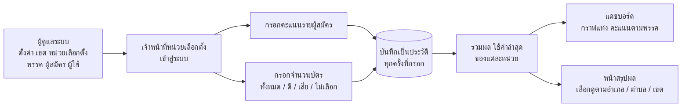

# Election Score Recording System (Case Study)

ระบบเว็บบันทึกและสรุปคะแนนผลการเลือกตั้งระดับท้องถิ่น (เทศบาล) เจ้าหน้าที่ประจำหน่วยเลือกตั้งกรอกคะแนนและจำนวนบัตร ระบบรวมผลตามเขต และแสดงผลบนแดชบอร์ดให้ดูเป็นภาพรวมได้ทันที

**สถานะ:** ส่งมอบให้เจ้าของบริษัทนำไปใช้ ใช้งานช่วงสั้นๆ ไม่ได้ใช้ต่อเนื่อง (ไม่ขอระบุว่าใช้ในการเลือกตั้งจริง)
**ลักษณะงาน:** โปรเจกต์ทีมเล็ก (ผม + นักศึกษาฝึกงาน รวม 3 คน) ได้เวลาทำเวอร์ชันแรกประมาณ **1 สัปดาห์ รวมเสาร์-อาทิตย์** ปลาย ม.ค. พ.ศ. 2568 (2025) แล้วกลับมาปรับอีกรอบเดือน พ.ค. พ.ศ. 2568 ผมเป็นผู้พัฒนาหลักของส่วนกรอกคะแนน การรวมผล และแดชบอร์ด
**โค้ด:** อยู่ใน private repository ยินดีอธิบายเชิงเทคนิคในการสัมภาษณ์

---

## ระบบทำงานอย่างไร

**บทบาทผู้ใช้**
- **ผู้ดูแลระบบ:** ตั้งค่าข้อมูลหลักทั้งหมด และกรอกคะแนนแทนได้ทุกหน่วย
- **เจ้าหน้าที่ประจำเขต:** กรอกได้เฉพาะหน่วยเลือกตั้งของเขตตัวเอง

## ส่วนที่ผมรับผิดชอบ
- **กรอกคะแนน:** หน้าจอกรอกคะแนนรายผู้สมัคร และจำนวนบัตรดี/เสีย/ไม่เลือกของแต่ละหน่วย แยกตามตำแหน่งที่เลือก
- **รวมผลและแดชบอร์ด:** query รวมคะแนนตามพรรค/ผู้สมัคร กรองตามอำเภอ ตำบล เขต และกราฟแท่งแสดงผล
- **หน้าแรกแสดงผลสรุป** ที่เลือกดูรายพื้นที่ได้
- **โครงสร้างฐานข้อมูล** และไฟล์ patch สำหรับอัปเดต schema ระหว่างพัฒนา
- **ปรับระบบให้รองรับการเลือกตั้งเทศบาล** จากโจทย์เดิมที่เป็นระดับจังหวัด (นายก อบจ. / ส.อบจ.) ในรอบพัฒนาเดือน พ.ค. พ.ศ. 2568
- **สิทธิ์ผู้ดูแล:** ให้ผู้ดูแลกรอกคะแนนแทนได้ทุกหน่วย
- รวมและตรวจ branch ของสมาชิกในทีมเข้ากับสาย `dev` ส่วนนักศึกษาฝึกงานทำหน้าตั้งค่าพรรค ตำแหน่ง ผู้สมัคร และผู้ใช้

## เทคโนโลยี
PHP (CodeIgniter 3), MySQL, jQuery, AJAX (ส่ง JSON), Morris.js (กราฟแท่ง), Git (feature branch → `dev` → `main`)

## ข้อมูลหลักของระบบ
จังหวัด, อำเภอ, ตำบล, เขตเลือกตั้ง, หน่วยเลือกตั้ง, พรรค, ตำแหน่ง, ผู้สมัคร, ผู้ใช้, ประวัติการกรอกคะแนน (`log_count_score`), ประวัติการกรอกจำนวนบัตร (`log_count_ballot`), log ระบบ

---

## ปัญหาที่ท้าทาย: กรอกผิดแล้วแก้ ผลรวมต้องไม่คลาดเคลื่อน

**โจทย์:** เจ้าหน้าที่กรอกคะแนนด้วยมือ ย่อมมีกรอกผิดแล้วแก้ แต่ระบบเลือกตั้งไม่ควรลบหรือเขียนทับข้อมูลเดิมจนตรวจสอบย้อนหลังไม่ได้

**วิธีออกแบบ:** ทุกครั้งที่กรอกจะ **เพิ่มแถวใหม่** ในตารางประวัติ พร้อมเวลาและผู้กรอก ไม่แก้แถวเดิม เวลารวมผลจะเลือกเฉพาะ **การกรอกล่าสุดของแต่ละหน่วย** มาบวก ผลคือกรอกซ้ำแก้ไขได้โดยคะแนนไม่ถูกนับซ้ำ และยังเหลือประวัติว่าใครกรอกอะไรเมื่อไร

**สิ่งที่ได้เรียนรู้:** ข้อมูลที่ต้องตรวจสอบย้อนหลังได้ควรเก็บเป็นประวัติ (append-only) แล้วให้ชั้นรวมผลเลือกค่าที่ใช้ ดีกว่าแก้ข้อมูลเดิม

## ปัญหาที่ท้าทาย: เวลาแค่ 1 สัปดาห์
ต้องส่งของใช้ได้ภายใน 1 สัปดาห์ รวมเสาร์-อาทิตย์ ด้วยทีม 3 คน ผมจึงเลือกสแตกที่ทีมถนัด (CodeIgniter) แบ่งงานตามโมดูลให้แต่ละคนทำคนละ branch แล้วรวมเข้า `dev` ทุกวัน และให้ตัวเองดูส่วนที่เสี่ยงที่สุดก่อน คือกรอกคะแนนกับรวมผล ส่วนหน้าตั้งค่าที่เป็นงานซ้ำๆ (CRUD) ให้ทีมทำคู่ขนาน

## ปัญหาที่ท้าทาย: requirement เปลี่ยนกลางทาง
ช่วงแรกทำตามโจทย์ระดับจังหวัด (นายก อบจ. / ส.อบจ. เฉพาะชลบุรี) แล้วโจทย์เปลี่ยนเป็นเลือกตั้งเทศบาล ต้องปรับโครงสร้างเขต หน่วยเลือกตั้ง ตำแหน่ง และหน้ากรอกคะแนนทั้งชุด ทำให้ได้ฝึกออกแบบ schema ให้ยืดหยุ่นและแก้ด้วย patch SQL โดยไม่ต้องทำใหม่หมด

## ขั้นต่อไปที่ควรปรับปรุง
- ใช้ query แบบ parameterized (query binding) ในหน้าสรุปผลแทนการต่อสตริง เพื่อกัน SQL injection
- แยก config และข้อมูลลับออกจาก repository และเก็บไฟล์ฐานข้อมูลจริงไว้นอก git
- เพิ่ม unit test ของ logic รวมผล และปิดการกรอกเมื่อปิดหีบ

## สิ่งที่ได้เรียนรู้
- ออกแบบระบบที่ความถูกต้องของตัวเลขสำคัญ พร้อมประวัติตรวจสอบย้อนหลัง
- แบ่งสิทธิ์ผู้ใช้ตามพื้นที่รับผิดชอบ
- ส่งระบบที่ใช้งานได้ภายใน 1 สัปดาห์ โดยจัดลำดับความสำคัญและแบ่งงานให้ทีม
- ทำงานเป็นทีมเล็กกับนักศึกษาฝึกงาน รวม branch และตรวจงาน
- รับมือ requirement ที่เปลี่ยนระหว่างทาง